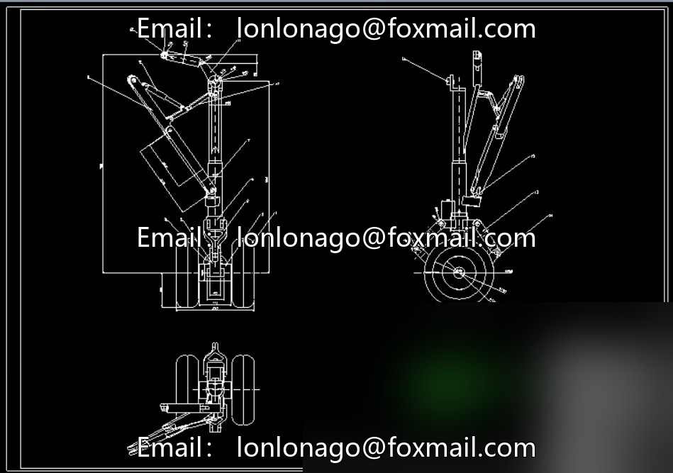

# Three-dimensional model to two-dimensional graph design

## Body

3D model to 2D image design, 3D to 2D image output. 3D model to 2D image conversion, conversion to 2D image.
Output 2D image,
Handle various 3D to 2D design tasks.
sw to CAD, SolidWorks to 2D image, Catia to CAD to 2D image, UG to CAD to 2D image.

The service provides conversion of 3D models to 2D designs and accepts various 3D-to-2D design requests.

<!-- AI_ENRICHED -->

## Images

## Payment

Here is a pay link on Stripe ( https://buy.stripe.com/3cs8yP7sY87d0vu9AB ). Please contact me lonlonago@foxmail.com after funding $89, and I will send you a complete data files , thank you!

